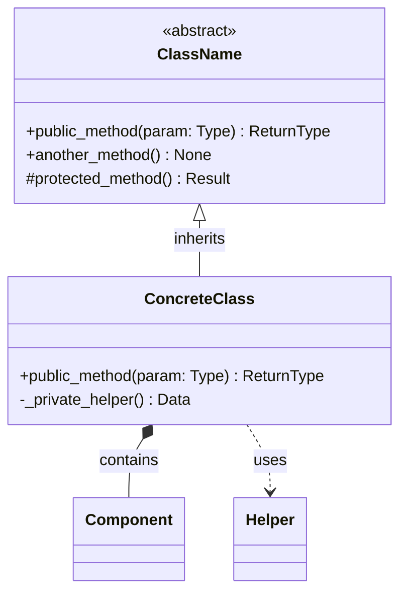

# Python API Surface Extraction Guide

Methodology for systematically extracting and documenting the public API surface of Python modules.

<!-- mdformat-toc start --slug=github --maxlevel=3 --minlevel=2 -->

- [Step 1: Identify Public Symbols](#step-1-identify-public-symbols)
  - [Check `__all__` First](#check-__all__-first)
  - [No `__all__` — Use Naming Convention](#no-__all__-%E2%80%94-use-naming-convention)
  - [Priority Order for Documentation](#priority-order-for-documentation)
- [Step 2: Extract Signatures](#step-2-extract-signatures)
  - [Extraction Pattern](#extraction-pattern)
  - [Class Method Extraction](#class-method-extraction)
- [Step 3: Map Dependencies](#step-3-map-dependencies)
  - [Internal Dependencies (What This Module Imports)](#internal-dependencies-what-this-module-imports)
  - [External Dependencies](#external-dependencies)
  - [Reverse Dependencies (What Imports This Module)](#reverse-dependencies-what-imports-this-module)
- [Step 4: Generate Quick-Reference Table](#step-4-generate-quick-reference-table)
  - [Format](#format)
  - [Rules](#rules)
- [Step 5: Generate Mermaid Class Diagram](#step-5-generate-mermaid-class-diagram)
  - [When to Create](#when-to-create)
  - [Extraction Rules](#extraction-rules)
  - [Diagram Template](#diagram-template)
  - [Relationship Types](#relationship-types)
- [Step 6: Identify Usage Examples](#step-6-identify-usage-examples)
  - [What Makes a Good Example](#what-makes-a-good-example)
  - [Example Categories to Include](#example-categories-to-include)
  - [Example Format](#example-format)
- [Checklist](#checklist)

<!-- mdformat-toc end -->

---

## Step 1: Identify Public Symbols<a name="step-1-identify-public-symbols"></a>

### Check `__all__` First<a name="check-__all__-first"></a>

```python
# If __all__ is defined, it IS the public API
__all__ = ["ClassName", "function_name", "CONSTANT"]
```

If `__all__` exists, only document symbols listed in it. Everything else is internal.

### No `__all__` — Use Naming Convention<a name="no-__all__-%E2%80%94-use-naming-convention"></a>

If no `__all__`, the public API consists of:

- All classes, functions, and constants that do NOT start with `_`
- Excluding anything imported solely for internal use

### Priority Order for Documentation<a name="priority-order-for-documentation"></a>

1. Classes (with their public methods)
2. Module-level functions
3. Type aliases and protocols
4. Constants and configuration objects
5. Exceptions

---

## Step 2: Extract Signatures<a name="step-2-extract-signatures"></a>

For each public symbol, extract:

| Field       | Source                             | Example                                                        |
| ----------- | ---------------------------------- | -------------------------------------------------------------- |
| Name        | Definition line                    | `process_batch`                                                |
| Type        | `class` / `def` / assignment       | function                                                       |
| Signature   | Full type-annotated signature      | `(items: list[Item], *, timeout: float = 30.0) -> BatchResult` |
| Description | First line of docstring            | Processes a batch of items with configurable timeout.          |
| Module      | File path relative to package root | `package.processing.batch`                                     |

### Extraction Pattern<a name="extraction-pattern"></a>

For each `.py` file in the module:

```
1. Read the file
2. Find __all__ (if present)
3. For each public symbol:
   a. Extract the full signature with type annotations
   b. Extract the first line of the docstring (or infer from name)
   c. Note inheritance (for classes)
   d. Note decorators (@abstractmethod, @classmethod, @property, @overload)
```

### Class Method Extraction<a name="class-method-extraction"></a>

For classes, also extract public methods:

```
1. List all methods not starting with _
2. Include @property decorators
3. Include @classmethod and @staticmethod
4. Note which methods are abstract
5. Note which methods are inherited vs overridden
```

---

## Step 3: Map Dependencies<a name="step-3-map-dependencies"></a>

### Internal Dependencies (What This Module Imports)<a name="internal-dependencies-what-this-module-imports"></a>

```python
# Look for imports from the same package
from package.core import Engine       # -> depends on package.core
from package.utils import retry       # -> depends on package.utils
from .base import BaseHandler         # -> depends on same-package .base
```

Record as:

| Imported From   | Symbols            | Purpose                         |
| --------------- | ------------------ | ------------------------------- |
| `package.core`  | `Engine`, `Config` | Core processing engine          |
| `package.utils` | `retry`, `Timer`   | Resilience and timing utilities |

### External Dependencies<a name="external-dependencies"></a>

```python
# Look for third-party imports
import pydantic                       # -> external: pydantic
from httpx import AsyncClient         # -> external: httpx
```

### Reverse Dependencies (What Imports This Module)<a name="reverse-dependencies-what-imports-this-module"></a>

To find reverse dependencies, grep across the package for imports from this module:

```
Grep for:
- "from package.module_name import"
- "import package.module_name"
```

Record as:

| Module          | Symbols Used                | Purpose              |
| --------------- | --------------------------- | -------------------- |
| `package.api`   | `Handler`, `create_handler` | Exposes via REST API |
| `package.tests` | `MockHandler`               | Test fixtures        |

---

## Step 4: Generate Quick-Reference Table<a name="step-4-generate-quick-reference-table"></a>

### Format<a name="format"></a>

```markdown
## API Quick Reference

| Symbol | Type | Signature | Description |
|--------|------|-----------|-------------|
| `ClassName` | class | — | One-line description |
| `function_name` | function | `(param: Type) -> ReturnType` | One-line description |
| `CONSTANT_NAME` | `str` | `"value"` | One-line description |
| `TypeAlias` | type | `dict[str, list[int]]` | One-line description |
```

### Rules<a name="rules"></a>

- Keep descriptions to ONE line (< 80 chars)
- Show full signatures for functions (abbreviated if > 60 chars)
- For classes, signature column shows `—` (methods are in the detail section)
- Group by type: classes first, then functions, then types, then constants
- Sort alphabetically within each group

---

## Step 5: Generate Mermaid Class Diagram<a name="step-5-generate-mermaid-class-diagram"></a>

### When to Create<a name="when-to-create"></a>

- Module has 2+ classes with inheritance relationships
- Module has classes that compose/aggregate other classes
- Module uses Protocol/ABC patterns

### Extraction Rules<a name="extraction-rules"></a>

```
1. Identify all classes in the module
2. Map inheritance: class Child(Parent)
3. Map composition: self.component = Component()
4. Map usage: method calls another class
5. Include only PUBLIC methods in the diagram (skip _ and __)
6. Limit to 3-5 methods per class (most important ones)
```

### Diagram Template<a name="diagram-template"></a>



### Relationship Types<a name="relationship-types"></a>

| Arrow   | Meaning          | When to Use                  |
| ------- | ---------------- | ---------------------------- |
| `<\|--` | Inheritance      | `class Child(Parent)`        |
| `*--`   | Composition      | `self.x = X()` in `__init__` |
| `o--`   | Aggregation      | `self.x` assigned externally |
| `..>`   | Dependency/Usage | Method calls or imports      |

---

## Step 6: Identify Usage Examples<a name="step-6-identify-usage-examples"></a>

### What Makes a Good Example<a name="what-makes-a-good-example"></a>

1. **Self-contained** — includes all imports, can be copy-pasted and run
2. **Shows output** — includes expected result as comment
3. **Progressive** — basic usage first, then advanced
4. **Realistic** — demonstrates actual use case, not contrived

### Example Categories to Include<a name="example-categories-to-include"></a>

| Category            | When                       | Template                              |
| ------------------- | -------------------------- | ------------------------------------- |
| Basic instantiation | Always                     | Create object, call primary method    |
| Configuration       | If configurable            | Show config options and their effects |
| Error handling      | If exceptions defined      | Show try/except with specific errors  |
| Integration         | If used with other modules | Show how modules compose              |
| Advanced/Custom     | If extensible              | Show subclassing or plugin pattern    |

### Example Format<a name="example-format"></a>

```python
from package.module import ClassName

# Initialize with required configuration
instance = ClassName(
    required_param="value",
    optional_param=42,
)

# Perform the primary operation
result = instance.process(input_data)
print(result)  # Expected: Result(status='ok', count=3)

# Access computed properties
print(instance.summary)  # Expected: "Processed 3 items in 0.5s"
```

---

## Checklist<a name="checklist"></a>

Before completing documentation for any module, verify:

- [ ] All `__all__` symbols are documented
- [ ] All public classes have their public methods listed
- [ ] Signatures include full type annotations
- [ ] Internal dependencies are mapped (imports from same package)
- [ ] External dependencies are listed (third-party packages)
- [ ] Reverse dependencies identified (what imports this module)
- [ ] At least one copy-pasteable usage example per major class/function
- [ ] Mermaid diagram created (if 2+ related classes exist)
- [ ] Quick-reference table is complete and sorted
