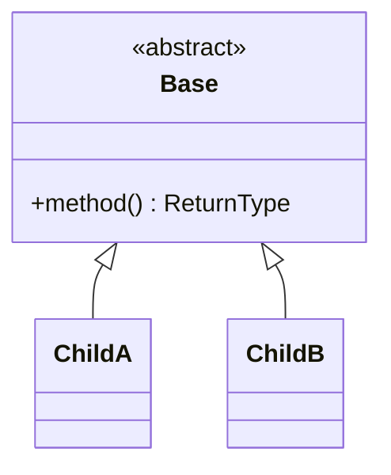
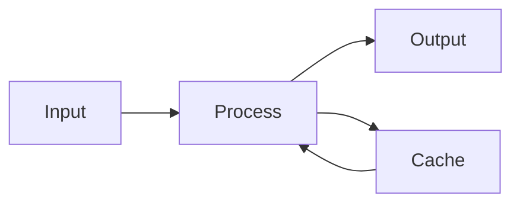
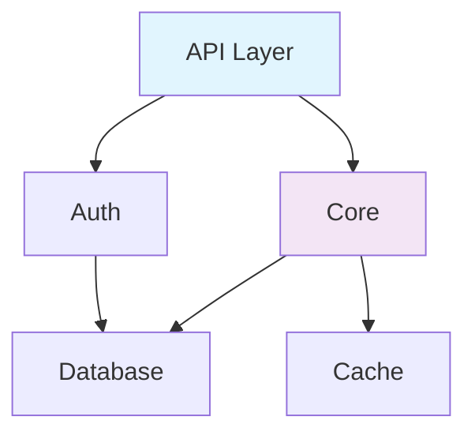
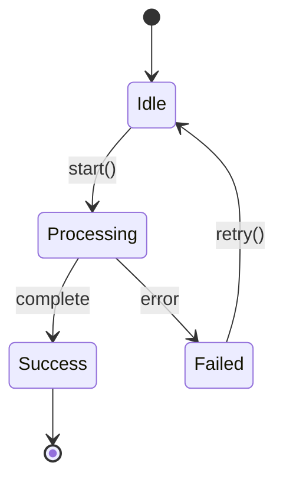

# README Templates Reference

Templates for GitHub-optimized Python project documentation. All templates use features that render natively in GitHub's
web UI: Mermaid diagrams, collapsible sections, tables, badges, and relative links.

<!-- mdformat-toc start --slug=github --maxlevel=3 --minlevel=2 -->

- [Root README Template](#root-readme-template)
- [Module README Template](#module-readme-template)
- [Small Module README Template](#small-module-readme-template)
- [Collapsible Section Patterns](#collapsible-section-patterns)
  - [For Long Method Lists](#for-long-method-lists)
  - [For Extended Examples](#for-extended-examples)
  - [For Implementation Notes](#for-implementation-notes)
- [Mermaid Diagram Patterns](#mermaid-diagram-patterns)
  - [Class Hierarchy (Top-Down)](#class-hierarchy-top-down)
  - [Data Flow (Left-Right)](#data-flow-left-right)
  - [Module Dependencies (Top-Down)](#module-dependencies-top-down)
  - [State Machine](#state-machine)
- [Badge Patterns](#badge-patterns)
- [Navigation Patterns](#navigation-patterns)
  - [Breadcrumb (Always First Line)](#breadcrumb-always-first-line)
  - [Internal Table of Contents (For READMEs > 100 lines)](#internal-table-of-contents-for-readmes--100-lines)
  - [Cross-Module References](#cross-module-references)

<!-- mdformat-toc end -->

---

## Root README Template<a name="root-readme-template"></a>

````markdown
# Project Name

[]()
[]()
[]()

Brief one-paragraph description of the project: what it does, who it's for, and what makes it
distinctive.

## Quick Start

### Installation

\```bash
uv pip install -e .
\```

### Basic Usage

\```python
from package_name import MainClass

# Initialize with default configuration
client = MainClass(config_path="config.yaml")

# Perform primary operation
result = client.process(input_data)
print(result)  # Expected: ProcessResult(status='success', items=42)
\```

## Architecture

\```mermaid
graph TD
    A[Client Code] --> B[Public API Layer]
    B --> C[Core Engine]
    B --> D[Plugin System]
    C --> E[Data Store]
    D --> F[Built-in Plugins]
    D --> G[Custom Plugins]
    C --> H[Transport Layer]

    style B fill:#e1f5fe
    style C fill:#f3e5f5
    style D fill:#e8f5e9
\```

## Module Documentation

### Core Infrastructure

| Module | Description | Files |
|--------|-------------|-------|
| [`core/`](./package/core/README.md) | Core engine and data processing | 8 |
| [`api/`](./package/api/README.md) | Public API surface and client interfaces | 5 |
| [`config/`](./package/config/README.md) | Configuration management and validation | 3 |

### Domain Modules

| Module | Description | Files |
|--------|-------------|-------|
| [`devices/`](./package/devices/README.md) | Device management and communication | 12 |
| [`protocols/`](./package/protocols/README.md) | Protocol implementations (USB, BT, WiFi) | 9 |

### Supporting Infrastructure

| Module | Description | Files |
|--------|-------------|-------|
| [`utils/`](./package/utils/README.md) | Shared utilities and helpers | 6 |
| [`errors/`](./package/errors/README.md) | Exception hierarchy and error handling | 2 |
| [`testing/`](./package/testing/README.md) | Test utilities and fixtures | 4 |

## Development

### Setup

\```bash
git clone <repo-url>
cd project
uv sync --dev
\```

### Running Tests

\```bash
uv run pytest
uv run pytest --cov=package_name
\```

### Code Quality

\```bash
uv run ruff check .
uv run ruff format .
\```

## Dependencies

| Package | Purpose | Version |
|---------|---------|---------|
| `pydantic` | Data validation and settings | ^2.0 |
| `httpx` | Async HTTP client | ^0.25 |
| `rich` | Terminal output formatting | ^13.0 |
````

---

## Module README Template<a name="module-readme-template"></a>

````markdown
[Project Root](../../README.md) > [Category](../README.md) > **Module Name**

---

# Module Name

Brief description of what this module does and its role in the broader system.

## Architecture

\```mermaid
classDiagram
    class BaseHandler {
        <<abstract>>
        +handle(request: Request) Response
        +validate(data: dict) bool
        #_process(raw: bytes) Result
    }

    class ConcreteHandlerA {
        +handle(request: Request) Response
        -_transform(data: Data) Output
    }

    class ConcreteHandlerB {
        +handle(request: Request) Response
        -_aggregate(items: list) Summary
    }

    BaseHandler <|-- ConcreteHandlerA
    BaseHandler <|-- ConcreteHandlerB
    ConcreteHandlerA ..> DataTransformer : uses
    ConcreteHandlerB ..> DataAggregator : uses
\```

## API Quick Reference

| Symbol | Type | Description |
|--------|------|-------------|
| `BaseHandler` | ABC | Abstract base for all request handlers |
| `ConcreteHandlerA` | class | Handles transformation requests |
| `ConcreteHandlerB` | class | Handles aggregation requests |
| `create_handler` | function | Factory function for handler instantiation |
| `HandlerConfig` | TypedDict | Configuration schema for handlers |
| `HANDLER_REGISTRY` | dict | Global registry of available handlers |

## Core Components

### `BaseHandler`

Abstract base class for all request handlers. Defines the processing contract.

\```python
from package.module import BaseHandler, HandlerConfig

class MyHandler(BaseHandler):
    def handle(self, request: Request) -> Response:
        validated = self.validate(request.data)
        return self._process(request.raw)
\```

<details>
<summary><strong>Full Method Reference</strong></summary>

| Method | Signature | Description |
|--------|-----------|-------------|
| `handle` | `(request: Request) -> Response` | Process an incoming request |
| `validate` | `(data: dict) -> bool` | Validate request data against schema |
| `_process` | `(raw: bytes) -> Result` | Internal processing logic (override in subclass) |
| `configure` | `(config: HandlerConfig) -> None` | Apply configuration settings |

</details>

### `ConcreteHandlerA`

Handles data transformation requests. Converts raw input into structured output.

\```python
from package.module import ConcreteHandlerA

handler = ConcreteHandlerA(config={"format": "json", "strict": True})
result = handler.handle(request)
print(result.status)  # "success"
print(result.data)    # {"transformed": [...]}
\```

<details>
<summary><strong>Full Method Reference</strong></summary>

| Method | Signature | Description |
|--------|-----------|-------------|
| `handle` | `(request: Request) -> Response` | Transform request data to target format |
| `_transform` | `(data: Data) -> Output` | Core transformation logic |

</details>

## Data Flow

\```mermaid
flowchart LR
    A[Raw Input] --> B{Validate}
    B -->|Valid| C[Transform]
    B -->|Invalid| D[Error Response]
    C --> E[Post-process]
    E --> F[Response]

    style B fill:#fff3e0
    style D fill:#ffebee
    style F fill:#e8f5e9
\```

## Dependencies

### This Module Imports

| Module | What | Why |
|--------|------|-----|
| `package.core` | `Engine`, `Config` | Core processing engine |
| `package.utils` | `retry`, `Timer` | Retry logic and timing |
| `pydantic` | `BaseModel` | Data validation |

### Modules That Import This

| Module | What | Why |
|--------|------|-----|
| `package.api` | `BaseHandler`, `create_handler` | Exposes handlers via API |
| `package.testing` | `ConcreteHandlerA` | Test fixtures |

## Usage Examples

### Basic Usage

\```python
from package.module import create_handler

# Create a handler using the factory
handler = create_handler("transform", config={"format": "json"})

# Process a request
response = handler.handle(request)
assert response.status == "success"
\```

### Advanced: Custom Handler Registration

\```python
from package.module import BaseHandler, HANDLER_REGISTRY

class CustomHandler(BaseHandler):
    def handle(self, request):
        # Custom processing logic
        data = self.validate(request.data)
        return self._process(request.raw)

# Register for factory discovery
HANDLER_REGISTRY["custom"] = CustomHandler
\```

### Error Handling

\```python
from package.module import create_handler
from package.errors import HandlerError, ValidationError

try:
    handler = create_handler("transform")
    response = handler.handle(malformed_request)
except ValidationError as e:
    print(f"Invalid input: {e.field} - {e.message}")
except HandlerError as e:
    print(f"Processing failed: {e}")
\```
````

---

## Small Module README Template<a name="small-module-readme-template"></a>

For modules with 1-2 files, use this condensed format:

````markdown
[Project Root](../../README.md) > [Parent](../README.md) > **Module Name**

---

# Module Name

Brief description.

## API Reference

| Symbol | Type | Signature | Description |
|--------|------|-----------|-------------|
| `function_a` | function | `(x: int, y: str) -> Result` | Does X |
| `ClassA` | class | — | Manages Y |
| `CONSTANT` | str | — | Default Z value |

## Usage

\```python
from package.module import function_a

result = function_a(42, "hello")
print(result)  # Result(value=42, label="hello")
\```

## Dependencies

- **Imports from**: `package.core`, `package.utils`
- **Imported by**: `package.api`, `package.cli`
````

---

## Collapsible Section Patterns<a name="collapsible-section-patterns"></a>

### For Long Method Lists<a name="for-long-method-lists"></a>

```markdown
<details>
<summary><strong>All Methods (12)</strong></summary>

| Method | Signature | Description |
|--------|-----------|-------------|
| ... | ... | ... |

</details>
```

### For Extended Examples<a name="for-extended-examples"></a>

````markdown
<details>
<summary><strong>Advanced Configuration Example</strong></summary>

\```python
# Extended example code here...
\```

</details>
````

### For Implementation Notes<a name="for-implementation-notes"></a>

```markdown
<details>
<summary><strong>Implementation Details</strong></summary>

Technical explanation of algorithm, design decisions, or internal architecture
that most readers won't need but some will find valuable.

</details>
```

---

## Mermaid Diagram Patterns<a name="mermaid-diagram-patterns"></a>

### Class Hierarchy (Top-Down)<a name="class-hierarchy-top-down"></a>



### Data Flow (Left-Right)<a name="data-flow-left-right"></a>



### Module Dependencies (Top-Down)<a name="module-dependencies-top-down"></a>



### State Machine<a name="state-machine"></a>



---

## Badge Patterns<a name="badge-patterns"></a>

```markdown
<!-- Python version -->
[]()

<!-- Test status (static for internal projects) -->
[]()

<!-- Coverage -->
[]()

<!-- Platform -->
[]()

<!-- Framework -->
[]()
```

---

## Navigation Patterns<a name="navigation-patterns"></a>

### Breadcrumb (Always First Line)<a name="breadcrumb-always-first-line"></a>

```markdown
[Project Root](../../README.md) > [Devices](../README.md) > **USB Device Handler**
```

Adjust relative path depth based on actual directory nesting.

### Internal Table of Contents (For READMEs > 100 lines)<a name="internal-table-of-contents-for-readmes--100-lines"></a>

```markdown
## Table of Contents

- [Architecture](#architecture)
- [API Quick Reference](#api-quick-reference)
- [Core Components](#core-components)
- [Data Flow](#data-flow)
- [Dependencies](#dependencies)
- [Usage Examples](#usage-examples)
```

### Cross-Module References<a name="cross-module-references"></a>

```markdown
> **See also**: [`transport/`](../transport/README.md) for the underlying communication layer
> used by this module's device handlers.
```
